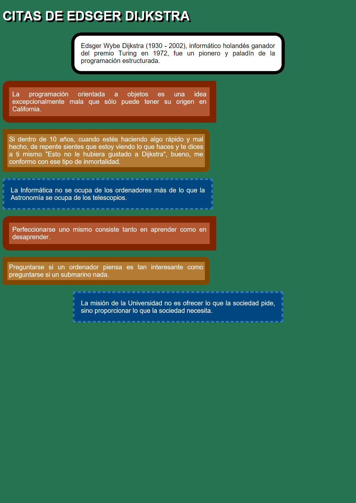

# El modelo de caja

Practica el [modelo de caja](https://www.w3schools.com/css/css_boxmodel.asp): contenido, padding, borde y margen. Abre cada HTML con Live Server.

## Cómo trabajar

1. Organiza primero el contenido HTML.
2. Crea una hoja CSS por ejercicio y enlázala desde su HTML.
3. Utiliza clases CSS para aplicar y reutilizar los estilos.
4. Escribe los colores en hexadecimal y las medidas en píxeles (`px`). Para centrar los bloques indicados, utiliza un ancho fijo y `margin: 20px auto`.

## Ejercicio 0. Margin y padding

Edita únicamente las partes señaladas con CHANGE ME de **0-modelo-caja.css** para reproducir la referencia. El HTML ya está preparado.

### Colores de referencia

Los colores aproximados de la captura corresponden a los que ya trae la plantilla:

| Elemento | Fondo | Borde |
| --- | --- | --- |
| DIV ONE | `#ffc0cb` | `#0000ff` |
| DIV TWO | `#add8e6` | `#800080` |
| DIV THREE | `#ffdab9` | `#a52a2a` |

Texto: `#000000`. Fondo de página: `#ffffff`.

### Autoevaluación

- Div One y Div Three tienen 32 px de relleno entre texto y borde.
- Div One tiene 12 px de margen por cada lado.
- Entre Div Two y Div Three hay 48 px.
- Div Three queda a la derecha mediante su margen izquierdo automático.

## Ejercicio 1. Citas de Dijkstra

Archivo: **1-citas-dijkstra.html**. Crea **1-citas-dijkstra.css** y enlázalo.

[Ver diseño esperado adaptado](1-dijkstra-esperado.png)

1. Usa un h1 para el título y un párrafo para cada texto de la plantilla.
2. Pon un fondo verde y un título blanco, en mayúsculas, con sombra negra.
3. Todas las cajas tendrán un ancho de contenido de 600 px. El padding y el borde se suman a ese ancho.
4. Centra únicamente la introducción y la última cita con `margin: 20px auto`.
5. Las cinco citas intermedias quedan alineadas a la izquierda, con `margin: 20px 0`.
6. Reproduce los tres estilos de cita: borde marrón con esquinas izquierdas redondeadas, borde naranja con esquinas derechas redondeadas y borde azul discontinuo.

### Valores y colores

| Clase sugerida | Fondo | Texto | Borde | Padding |
| --- | --- | --- | --- | --- |
| Introducción | `#ffffff` | `#000000` | 10 px sólido `#000000`, radio 30 px | 20 px |
| Cita marrón | `#b35733` | `#ffffff` | 20 px sólido `#802400`, radios izquierdos 20 px | 10 px |
| Cita naranja | `#b37b33` | `#ffffff` | 15 px sólido `#804800`, radios derechos 15 px | 5 px |
| Cita azul | `#004680` | `#ffffff` | 5 px discontinuo `#3379b3` | 20 px |

Fondo de página: `#267352`. Fuente: Arial o sans-serif, 20 px. Título: 40 px, sombra negra desplazada 5 px en horizontal y vertical. Conserva el orden de los textos; aplica los estilos marrón, naranja y azul y repite esa secuencia. La última cita utiliza el estilo azul y queda centrada.

## Ejercicio 2. Citas de Chesterton

Archivo: **2-chersteton.html**. Crea **2-chesterton.css** y enlázalo. Se conserva el nombre del archivo HTML existente.

[Referencia visual de colores y bloques](https://github.com/omiras/modelo-caja-pimec/assets/3286458/fab3d21b-1717-4600-9856-534206e24c25)

La distribución se adapta así:

- El body tiene un ancho de 900 px y `margin: 20px auto`.
- Usa header para el título y los dos párrafos introductorios, main para las citas y un section por tema: Capitalismo, Política y Progreso. Cada tema tiene un h2 y cada cita un p.
- Header: padding de 0 px arriba y abajo, 10 px a los lados. El título tiene margen 0 px y está centrado.
- Main: borde blanco de 2 px y padding de 10 px.
- Cada sección tiene 5 px de padding inferior y 40 px de separación respecto a la siguiente. Puedes aplicar una clase adicional a la segunda y tercera sección.
- Cada h2 tiene margen 0 px y padding izquierdo de 10 px.
- Cada cita tiene `margin: 20px 40px`, padding de 10 px, borde de 10 px e interlineado de 48 px.

### Colores y tamaños

| Elemento | Color |
| --- | --- |
| Fondo de página | `#997366` |
| Fondo de cabecera | `#998680` |
| Fondo de secciones | `#b39f99` |
| Fondo de títulos de sección y borde de main | `#ffffff` |
| Borde de citas | `#402d26` |
| Texto de citas | `#ffffff` |
| Texto general | `#000000` |

Fuente general: Arial o sans-serif, 24 px. Título principal: 64 px. Títulos de sección: 36 px. Los colores son aproximados; la referencia sirve para comparar fondos y bordes, y estas instrucciones concretan las medidas de la versión adaptada.

## Comprueba tu trabajo

- Las clases del HTML coinciden con las de tu hoja CSS.
- Distingues el margen exterior, el borde y el relleno interior.
- Has conservado los textos de las plantillas.
- En Dijkstra solo la primera y la última caja están centradas.
- En Chesterton el conjunto está centrado y las citas tienen espacio dentro de cada sección.
- Comprueba el resultado con una ventana amplia: los anchos fijos pueden superar el espacio disponible en una ventana estrecha.
